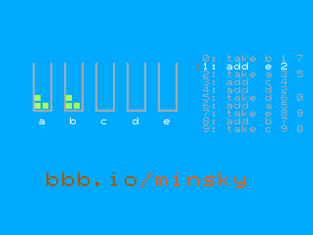

<!---
This file is used to generate your project datasheet.
-->

## How it works

In 1967 Marvin Minsky showed that a computer needs very little to compute
anything at all: a few boxes that hold pebbles, and two instructions.

- **add *r*** puts one pebble in box *r* and goes on to the next instruction.
- **take *r*** takes one pebble out of box *r* and goes on to the next
  instruction, but if box *r* is empty it jumps somewhere else instead.

This chip is such a machine, and it draws the whole VGA picture with only
those two instructions. It runs one instruction per clock (25.175 MHz).

**Drawing the screen.** Every pixel is one trip around a two-instruction
loop, `take` from one box and `add` to another, so each pixel is two clocks
wide (320 x 480 distinct pixels on a 640 x 480 screen). Minsky's machine has
no "load a number" instruction, so the boxes work in pairs: one line moves
320 pebbles from box A to box B, and the next line moves them back. The
porches, the sync pulses and the vertical regions are counted the same way.
Each instruction also carries the horizontal sync, vertical sync and
"video on" bits, which go straight to the monitor. The pebble counts that
are currently being filled are the pixel's column and row, and they look up
the colour of the demonstration and of the link at the bottom; all the
text uses a small font stored as ASCII art in `src/font.v`.

**The demonstration.** The same machine also runs a second program you can
watch: Minsky-style multiplication, from `src/demo_program.v`. Once every
16 frames, a spare instruction slot in the vertical blanking runs one of
its instructions. The left of the screen shows its five boxes, a to e, with
their real pebbles; the right shows its program, with an orange `>` at the
instruction being run. The listing is drawn from the same table the machine
executes. Each line reads: line number, instruction, box, next line, and
(for `take`) the line to go to if the box is empty. It multiplies a = 3 by
b = 4 into c (12 pebbles), puts a and b back, empties c and starts again,
every 99 instructions (about 26 seconds).

The colours are the BeagleBoard.org brand colours, as close as 2 bits per
channel allows; the link bbb.io/minsky is in hair brown and tongue orange,
like the BeagleBoard.org logo.

## How to test

1. Connect the Tiny VGA Pmod to the output pins and a monitor to the Pmod.
2. Set the clock to 25.175 MHz (25 MHz works on most monitors) and reset.
3. Watch the pebbles move between boxes a to e as the `>` steps through
   the program, and c fill up to 3 x 4 = 12.

In simulation, `test/render_frame.v` writes frames as images and checks the
sync timing, and `make` in `test/` runs the cocotb tests.

## External hardware

Tiny VGA Pmod (or any VGA Pmod with the same pinout), and a VGA monitor.
